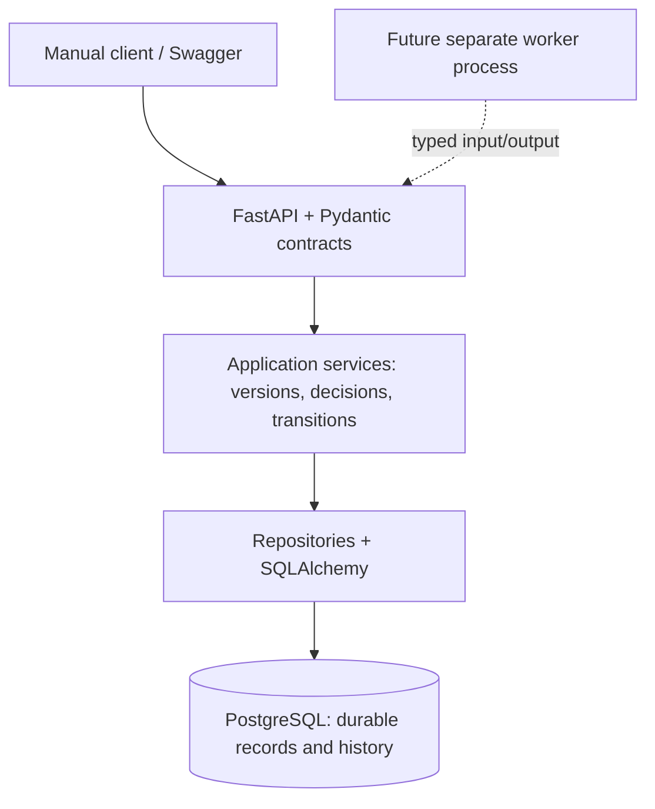

# SignalLoop Foundation v0.1 — review briefing

## Opening: what we can demonstrate

> SignalLoop now has a working persistent backbone for manually validating a product hypothesis. We can record what we believed, attach observations and their sources, describe an experiment, record its outcomes, explain a decision, and create a new hypothesis version without losing the old one. Today’s review demonstrates that loop and the rules that protect its history.

This is a technical foundation review. The camper-storage story is an explicitly simulated example, not market validation. No customer research, landing-page publishing or AI execution occurs during the demo.

**Review conclusion:** the manually operated Foundation v0.1 acceptance scenario works. The system is ready to support the design of one narrowly scoped research worker. It is not an autonomous platform or a production-ready public service.

## Suggested 12-minute presentation

| Time | Presenter action | Message |
|---|---|---|
| 0–2 min | Introduce purpose and scope | Persistent, explainable learning across hypothesis versions |
| 2–4 min | Walk through architecture and data model below | Code controls transitions; PostgreSQL retains business history |
| 4–7 min | Run demo sections 1–2 | The complete manual validation loop works over HTTP |
| 7–9 min | Run demo section 3 | Invalid changes fail and leave persisted state unchanged |
| 9–10 min | Run demo section 4 | Worker traces and human reviews have real persistence, without automation |
| 10–12 min | Show test results, limitations and next-milestone decision | Separate what is proven from what remains to build |

## What was built

| Capability | Current implementation | What it enables |
|---|---|---|
| Hypotheses and versions | Stable hypothesis identity, immutable snapshots, current-version pointer | Compare v1 with v2 and preserve original assumptions |
| Deterministic lifecycle | Central state map, row locking, atomic transitions, ordered history | Prevent skipped states and explain every accepted transition |
| Sources and evidence | Optional source links, stance, quotes, flexible facts, producer/run provenance | Trace information back to where it came from |
| Experiments and signals | Version-bound experiments; observed events and feedback | Keep what was tested separate from what happened |
| Decisions | Rationale, relational evidence/signal references and links to resulting versions | Explain why a hypothesis changed |
| Human reviews | Reviewer, decision, notes and one concrete foreign-key target | Retain approval/rejection/modification records |
| Agent runs | Provider-neutral model/prompt/input/output/cost/status fields | Store future worker traces without coupling to one AI vendor |
| Developer foundation | FastAPI/OpenAPI, PostgreSQL, Alembic, Docker Compose, pytest and Ruff | Run, inspect, migrate and test locally |

No production UI, authentication, agents, LLM calls, scraping, outreach or external execution was added. Both original architecture PDFs are preserved in `docs/`; the Foundation prompt defines the implemented scope.

## Architecture to explain



Mutating HTTP requests run in a transaction that commits before the response is sent. Hypothesis row locks serialize version numbering and state changes. Database constraints protect relationships, while append-only guards reject updates/deletes to historical snapshots. Business state transitions live in normal Python code, not an LLM or workflow framework.

The repository follows `src/signalloop/{api,domain,models,schemas,repositories,services,db}`, with migrations in `alembic/`, behavior tests in `tests/`, and runnable examples in `scripts/`.

There are **12 application tables**: the nine requested entities, transition history, and two decision-support join tables. PostgreSQL-native UUIDs, timezone-aware timestamps, decimal prices/currency, foreign keys and indexes cover core relationships. JSONB is reserved for flexible facts, metadata, payloads and run snapshots.

## Live demonstration

### Prepare

From the repository root:

```bash
docker compose up -d --build
docker compose ps
python scripts/review_demo.py --pause --output /tmp/signalloop-review-results.json
```

The script uses only the Python standard library. `--pause` stops before each of its four sections so the presenter can explain the next claim. Omit it for an unattended check. If using another API port, pass `--base-url http://localhost:8001`.

Keep [Swagger](http://localhost:8000/docs) open beside the terminal. The demo prints live hypothesis/history links and writes every check plus record IDs to JSON. It creates two simulated hypotheses and their linked records per successful run. Existing records remain untouched; there is no cleanup/delete operation.

### Section 1 — running API and contracts

**Say:** “The API is running against PostgreSQL, and its contracts are discoverable.”

Show `GET /health` returning `200 {"status":"ok"}` and OpenAPI exposing hypotheses, versions, runs and reviews. Health proves current database connectivity; migration checks below independently verify schema alignment.

### Section 2 — the manual learning loop

**Say:** “The starting price and problem are assumptions. The example evidence and events are simulated. We are demonstrating information flow and traceability, not demand.”

The demo performs:

```text
v1: removable rear storage, assumed price EUR 449
  DRAFT → FEASIBILITY → RESEARCH
  Source + Evidence: “I don't want to drill holes into my van.”
  READY_FOR_EXPERIMENT → create Landing Page Demand Test
  EXPERIMENT → simulated page_view / email_submit / price_objection
  EVALUATION → decision: iterate → ITERATION
v2: assumed price EUR 349, linked to the decision
  RESEARCH
```

Pause afterward to inspect versions, history and decisions in Swagger using the printed hypothesis ID.

**Expected proof:** v1 is still €449; v2 is €349; the current pointer is v2; the original experiment still references v1; the decision cites evidence and all three signals; the decision also exposes v2 as a resulting version. Eight ordered history entries include initial creation and the decision-driven transition.

### Section 3 — deliberately invalid actions

**Say:** “A successful happy path is insufficient. These requests should fail, and the stored data must remain unchanged.”

| Attempt | Expected response | Follow-up assertion |
|---|---|---|
| RESEARCH → VALIDATED | `409` | Status/history unchanged |
| Record `validate` while in RESEARCH | `409` | No decision or history added |
| PATCH old version | `405` | v1 remains byte-for-byte equal as decoded JSON |
| Evidence referencing a nonexistent Source | `404` | No evidence added |
| Signal with a timestamp lacking timezone | `422` | No signal added |
| Evidence referencing another hypothesis's version | `422` | No evidence added |

The live API test proves that no overwrite endpoint exists. The separate PostgreSQL integration suite goes further: direct SQL updates/deletes of historical versions fail too.

### Section 4 — traces and reviews without agent execution

**Say:** “A future worker can leave a durable trace, and a human review can reference that exact record. Storing a review does not execute anything.”

The demo creates a clearly labelled simulated AgentRun containing an interpretation, and a HumanReview referring to that run. Both are retrieved and checked. Signal count and hypothesis state remain unchanged. No model is called; the run reports zero cost.

## Verification commands for the review

```bash
# Behavioral tests against PostgreSQL, using disposable schemas:
docker compose --profile test run --build --rm test

# Schema head and drift:
docker compose exec -T api alembic current
docker compose exec -T api alembic check

# Native developer checks, after installing .[dev]:
.venv/bin/ruff check .
.venv/bin/ruff format --check .
```

The 29 automated tests cover the manual lifecycle, other allowed state branches, terminal states, relationship integrity, immutable records, rollback, concurrent version creation, competing transitions, same-transaction history ordering, API validation, and migration upgrade/downgrade/upgrade. Fixtures create isolated schemas rather than clearing development data.

The standalone review's 18 checks exercise the running HTTP server. These are complementary checks, not a claim of 47 independent pytest tests or comprehensive production assurance.

## Limits and decisions to discuss

- **Signals still rely on truthful input.** Contracts distinguish observations from interpretations but cannot prove that an event happened. These demo events are simulated.
- **Reviews are persisted, not enforced execution gates.** Authentication and externally consequential actions do not exist yet. A future worker needs an explicit proposal/approval policy.
- **Decision endpoints record effective decisions.** `iterate`, `pause`, `reject` and `validate` can change state. A future evaluator must not submit an unapproved proposal as an effective decision.
- **No resume policy yet.** PAUSED, REJECTED and VALIDATED have no outgoing transitions in the supplied v0.1 graph.
- **Criteria and experiment results are manual.** No metric computation, automated evaluation, experiment lifecycle updates, or real channel execution is implemented.
- **Worker lifecycle remains to be designed.** Run updates, retry/idempotency rules, scheduling and failure recovery are deferred.
- **API decimals are strings.** Equivalent values can return with different scales after PostgreSQL persistence, such as `"0"` and `"0.000000"`. Clients should compare them numerically. The review script does so.
- **One upstream test warning remains.** Starlette warns that its httpx-based TestClient path is deprecated; the current tests pass. Dependency pinning and public-service hardening are still outstanding.

**Proposed next review decision:** accept the manually operated persistent foundation and select exactly one source/channel for the first Research Worker. Define its typed contract, provenance, retry/idempotency and review requirements before implementing it. No next-milestone implementation is included in this review package.

## Recorded rehearsal results

Rehearsal completed at **2026-10-05T21:17:59.205740+00:00** (UTC). Application baseline: commit `80eb009` on `foundation-v0.1`. Review tooling/docs are added in the subsequent review commit; no application behavior was changed.

| Check | Observed result |
|---|---|
| Running HTTP review | **18/18 checks passed** |
| Fresh Python 3.12 container/PostgreSQL suite | **29 passed**, one upstream deprecation warning |
| Core lifecycle | v1 €449 → v2 €349; final RESEARCH; eight history records |
| Alembic | `0003 (head)`; no schema drift detected |
| Ruff and whitespace checks | Passed |

Full machine-readable evidence: [review-results.json](review-results.json). The first rehearsal caught the decimal-scale comparison detail described above; the final rehearsal compares numeric values and passes. Rehearsal records remain labelled simulated in the local database.

For immediate inspection of the successful rehearsal:

- [Hypothesis](http://localhost:8000/hypotheses/e6d7b56b-79bb-4081-b003-8a5f87383159)
- [Version 1](http://localhost:8000/hypotheses/e6d7b56b-79bb-4081-b003-8a5f87383159/versions/1) and [Version 2](http://localhost:8000/hypotheses/e6d7b56b-79bb-4081-b003-8a5f87383159/versions/2)
- [Ordered history](http://localhost:8000/hypotheses/e6d7b56b-79bb-4081-b003-8a5f87383159/history)
- [Decision and support links](http://localhost:8000/hypotheses/e6d7b56b-79bb-4081-b003-8a5f87383159/decisions)
- [Observed-event fixtures](http://localhost:8000/experiments/d140c7db-d814-49e0-83c7-46ab80775d0b/signals)
- [Simulated worker trace](http://localhost:8000/agent-runs/fd25f6ee-12ca-4638-9d68-e918fcc9fafe)
- [Human review](http://localhost:8000/human-reviews/4c4e08fa-6324-49b5-95ee-4890c4b6b3eb)

These links require the local API and its current PostgreSQL volume. The JSON report is a point-in-time record, not a substitute for rerunning the demonstration after code/data changes.
